<div align="center">


# 校园二手交易平台

**让校园里的闲置，流动起来**

*基于 Spring Boot 3 + Vue 3 的校园二手交易平台 · 开源毕业设计模板*

<br/>


[](https://gitee.com/zhang-san-zhangshan/esjypt)

</div>

---

## 💡 为什么做它

校园里每年都有大量教材、数码、生活用品在角落吃灰，而另一边又有同学正需要它们。
于是我把它做成了一个**真正能跑起来的完整项目**：登录注册、发布商品、分类检索、下单交易、
订单状态流转，前后端全部打通，可以直接用来做毕设演示，也可以作为你二次开发的地基。

## ✨ 项目亮点

| 能力 | 说明 |
| --- | --- |
| 🔐 账户体系 | 注册 / 登录 / 个人资料，登录态前端持久化 |
| 🛍️ 商品市场 | 发布、关键词搜索、分类筛选、分页浏览、详情、编辑、下架 |
| 🏷️ 分类管理 | 首次启动自动写入默认分类，后续可自由扩展 |
| 📦 订单交易 | 一键下单、我的订单（我买的 / 我卖出的）、状态机流转 |
| 🎨 精致 UI | Element Plus 组件 + 卡片式布局 + 右下角悬浮打赏 |
| 🧬 工程规范 | 全拼音命名、JPA 自动建表、开箱即跑 |

## 🚀 快速开始

### ① 启动后端

```bash
cd houduan
mvn spring-boot:run
# 默认 http://localhost:8080，首次启动自动建库并写入默认分类
```

### ② 启动前端

```bash
cd qianduan
npm install
npm run dev
# 默认 http://localhost:5173，已配置 /api 代理到后端 8080
```

## 🗄️ 技术栈

| 层 | 技术 | 版本 |
| --- | --- | --- |
| 后端框架 | Spring Boot | 3.4.5 |
| 运行环境 | Java | 21+（JDK 25 亦可） |
| 持久化 | Spring Data JPA + MySQL | 8 |
| 前端框架 | Vue | 3.4 |
| 构建工具 | Vite | 6 |
| UI 组件库 | Element Plus | 2.6 |

## 📦 目录结构

```text
.
├── houduan/                 # Spring Boot 后端
│   └── src/main/
│       ├── java/com/ershoujiaoyi/
│       │   ├── controller/  # 用户 / 商品 / 分类 / 订单
│       │   ├── entity/      # YongHu / ShangPin / FenLei / DingDan
│       │   ├── repository/  # JPA 仓库
│       │   └── config/      # 跨域 / 数据初始化
│       └── resources/application.yml
├── qianduan/                # Vue3 前端
│   ├── src/views/           # 登录 / 首页 / 详情 / 发布 / 订单 / 我的
│   ├── src/components/      # 悬浮打赏组件
│   └── public/images/       # 收款码
├── images/                  # 收款码原图
└── docs/logo.png            # 项目 Logo
```

## 🧩 业务流程

```text
用户 ─▶ 登录/注册 ─▶ 发布商品 ─▶ 浏览/搜索 ─▶ 下单 ─▶ 订单状态流转
                                     │
                                     └─▶ 我的订单 / 我的商品 / 下架
```

## 🖼️ 界面预览

> 演示账号：前台（普通用户）`cheshi1 / 123456`，后台（管理员）`admin / admin123`。
> 以下为各核心页面实机截图。

### 一、前台 · 普通用户端

#### 1. 登录页
左右分栏：左侧品牌介绍与互动笑脸，右侧登录 / 注册双 Tab，支持忘记密码找回。

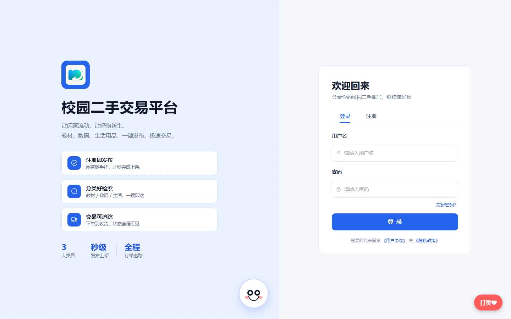

#### 2. 首页
顶部轮播 Banner、平台实时数据、分类快捷入口、好物市场商品网格，以及基于协同过滤的「猜你喜欢」个性化推荐。

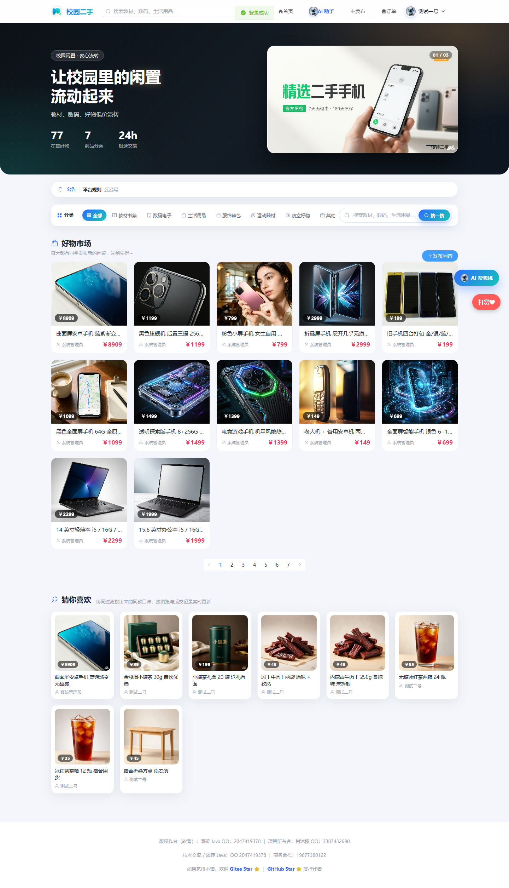

#### 3. 发布商品
填写标题、分类、价格、成色、描述并上传图片即可一键上架，支持图片预览。

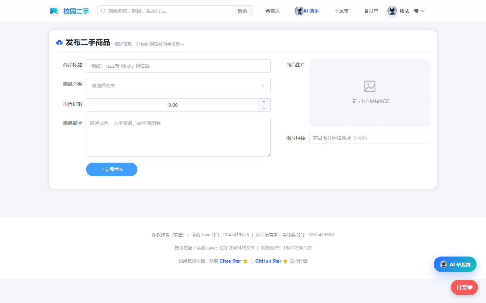

#### 4. 商品详情
大图展示、价格与描述、卖家信息卡片、「立即购买」下单入口，底部「看了又看」相关推荐。


#### 5. 我的订单
买家 / 卖家双视角订单列表，订单状态全程可追踪。

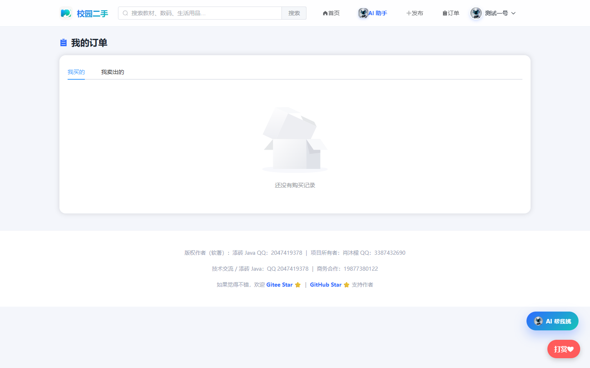

#### 6. 个人中心
个人资料维护（含头像上传）、我的发布、我的收藏等。

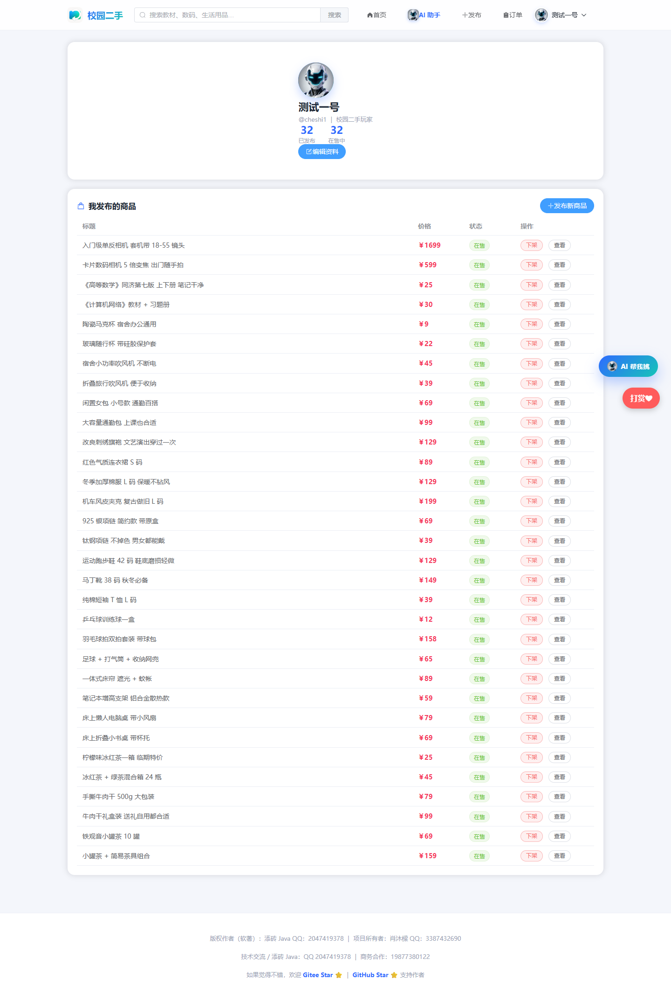

#### 7. AI 助手
接入大模型的智能购物助手，支持对话咨询与商品图片识别。

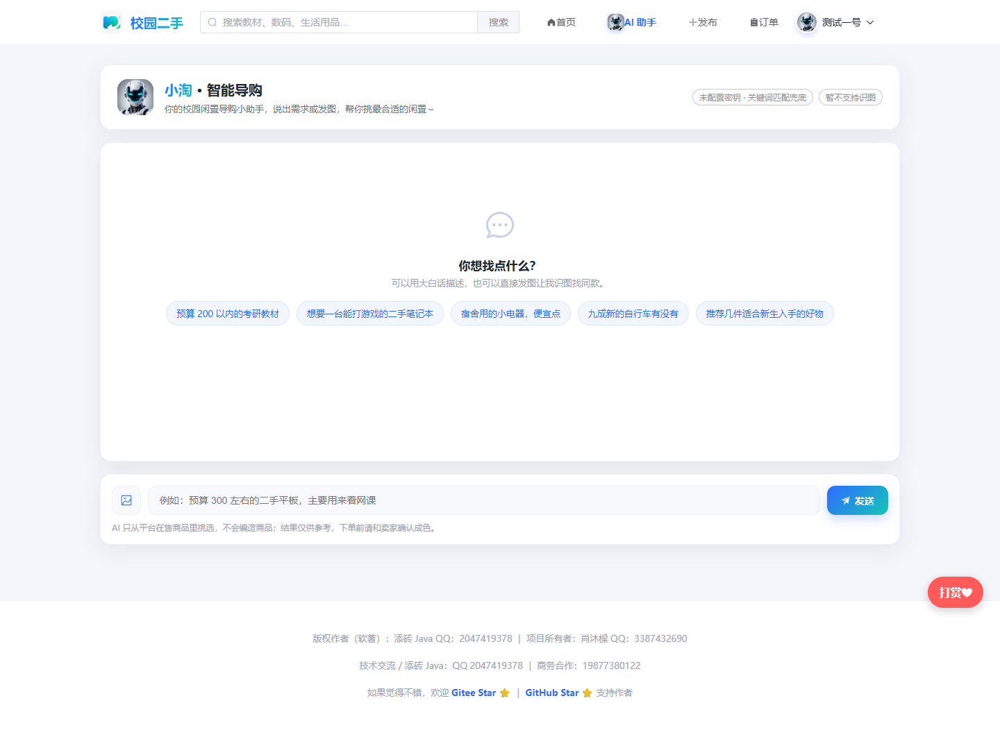

### 二、后台 · 管理员端

#### 8. 管理员登录
独立后台登录入口，品牌背景图 + 毛玻璃卡片；普通用户账号无法登录（服务端强校验管理员标志）。


#### 9. 数据概览
用户数、商品数、在售数、订单数等核心指标，分类商品分布与今日新增统计。

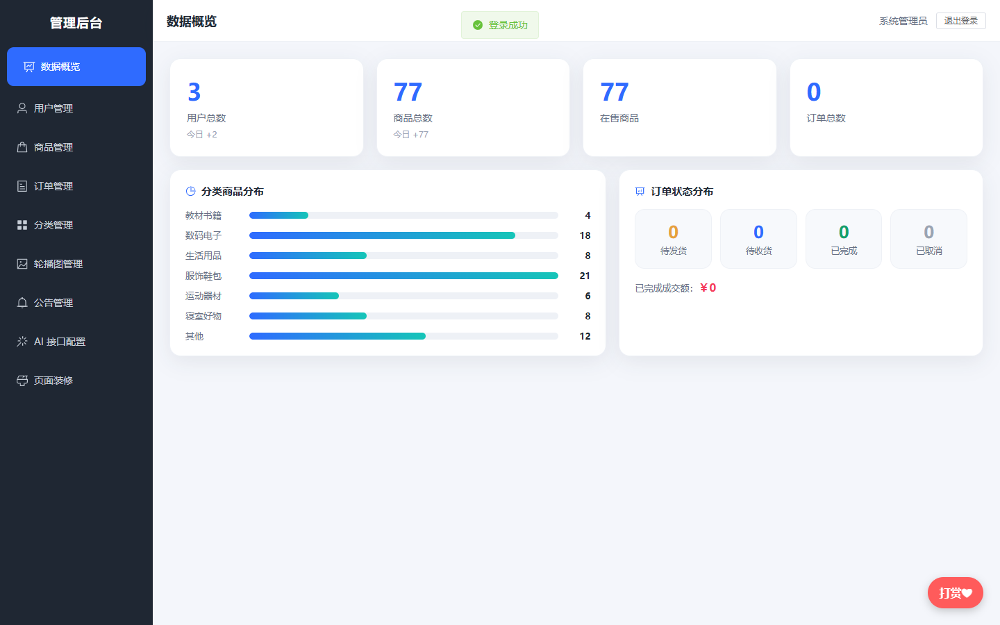

#### 10. 用户管理
用户列表支持搜索、设为 / 取消管理员、删除，并可**编辑用户资料**。

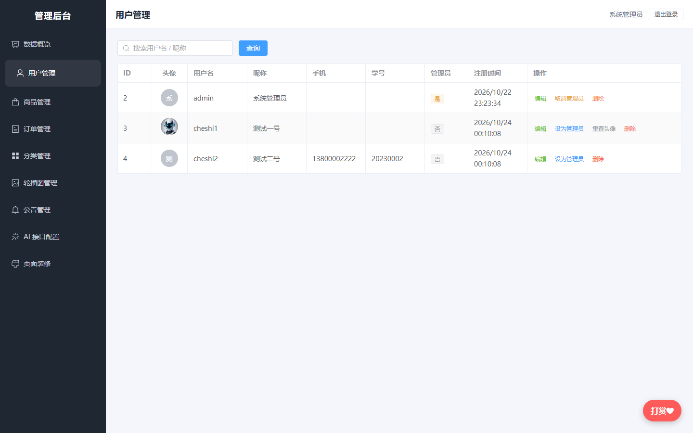

#### 11. 用户编辑弹窗
管理员可直接编辑用户资料（昵称 / 手机 / 学号）、重置密码（留空不改），并支持**上传 / 恢复头像**。

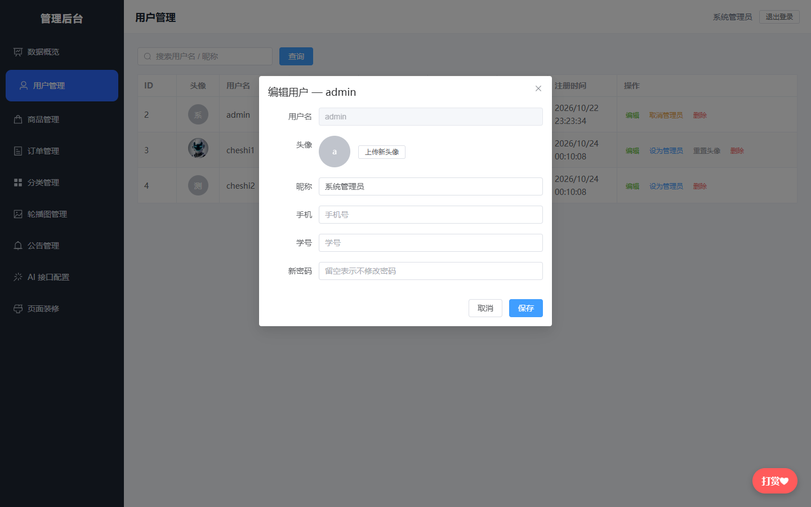

#### 12. 商品管理
全站商品列表，支持上 / 下架、编辑、删除等管理操作。

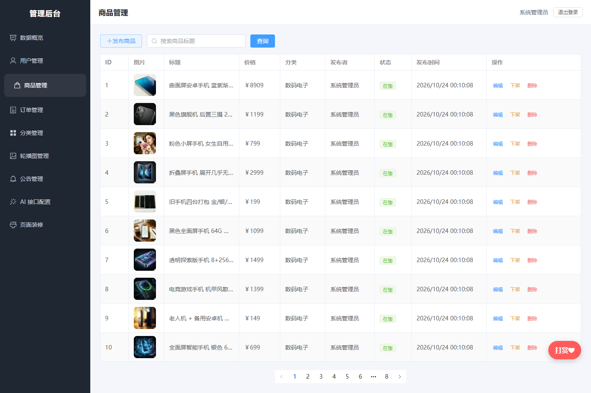

#### 13. 订单管理
全站订单列表，可调整订单状态。

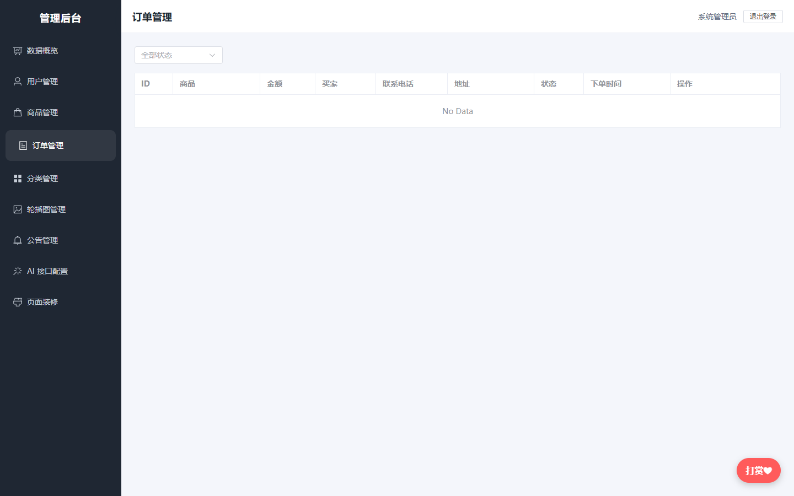

#### 14. 分类管理
商品分类的增删改，分类顺序与商品数量一目了然。

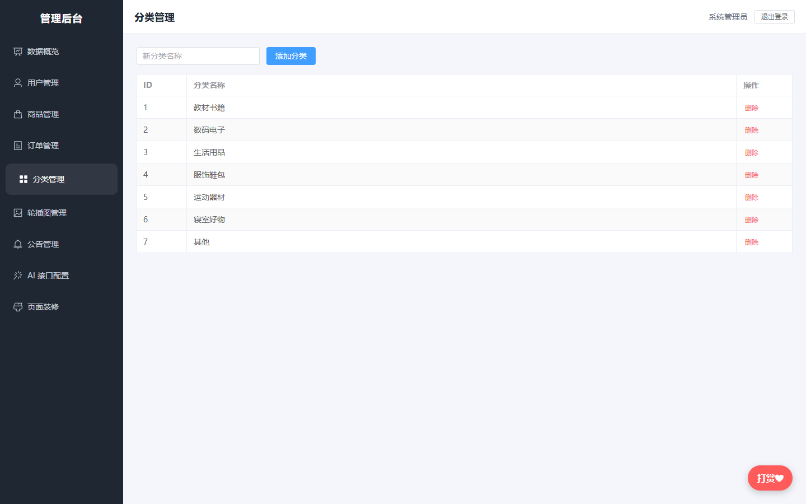

#### 15. 轮播图管理
首页 Banner 可视化管理：本地上传（16:9 裁剪预览）、标题 / 副标题 / 跳转链接、启用 / 停用与排序。

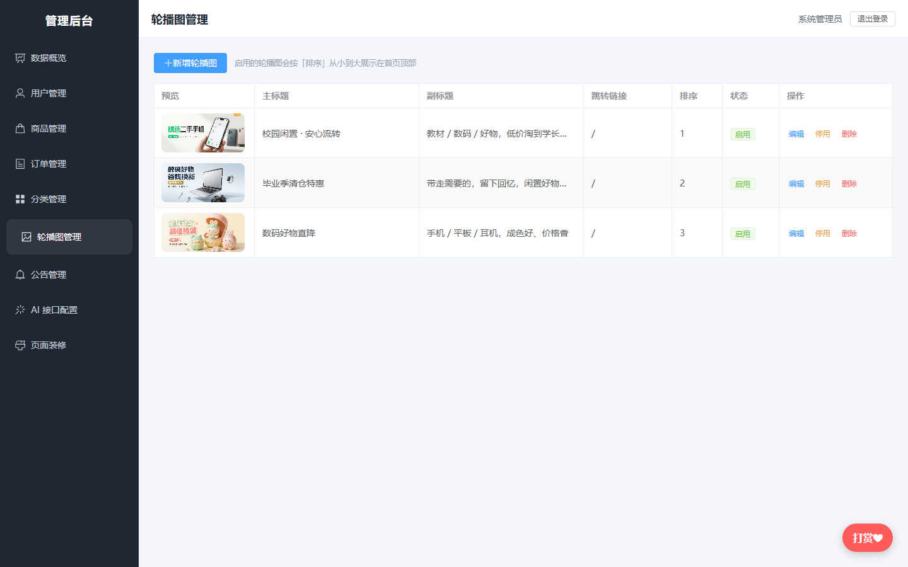

#### 16. 公告管理
平台公告的发布与编辑，前台滚动展示。

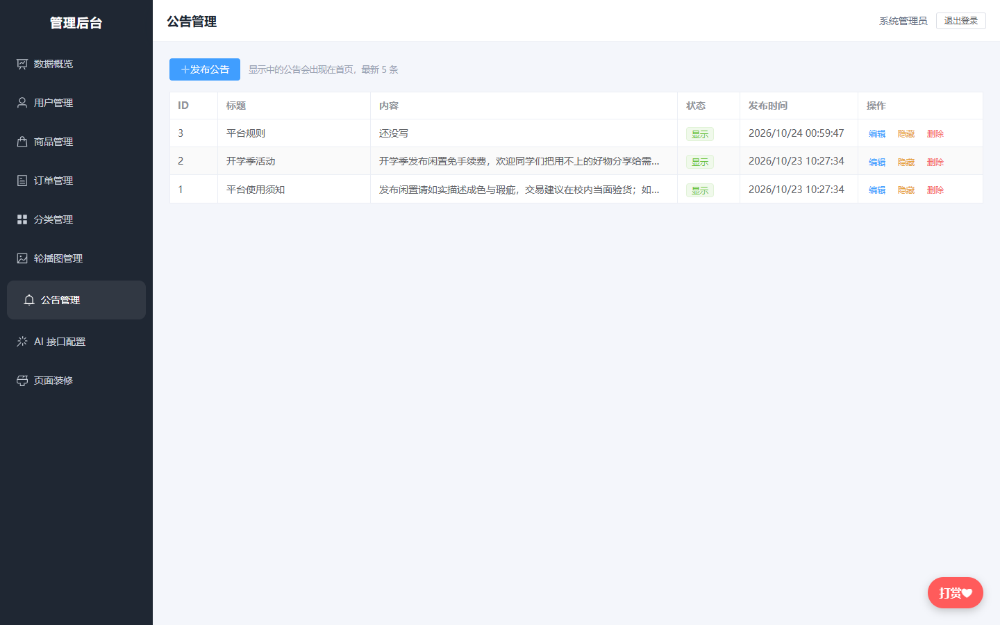

#### 17. AI 接口配置
管理大模型 API 密钥（服务商 / 地址 / 密钥），支持批量粘贴导入，供前台 AI 助手使用。

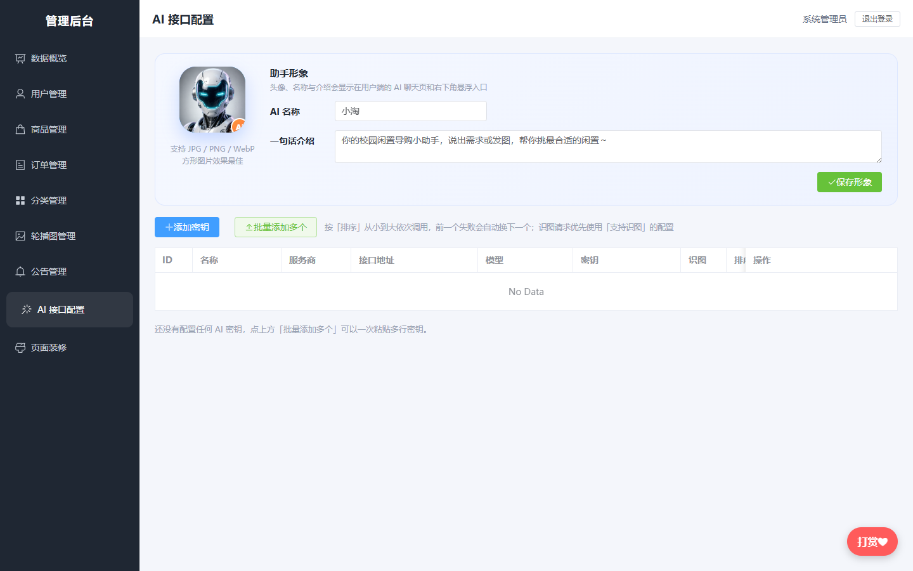

#### 18. 页面装修
管理员可自定义首页顶部宣传区文案：徽标、主标题（含高亮词）、描述、三个统计项标签，保存后前台即时生效。

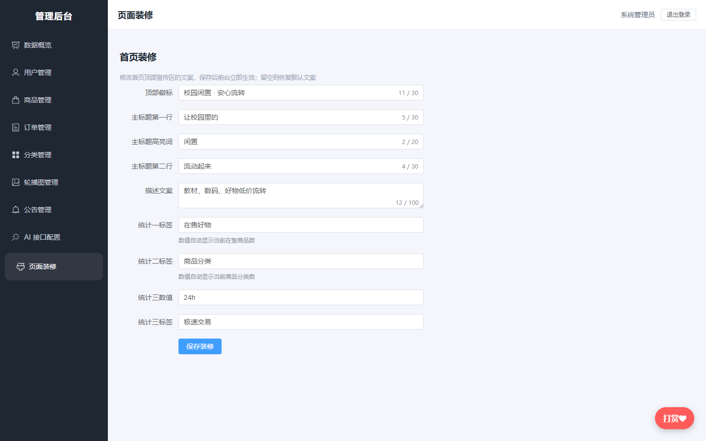

## ☕ 赞助作者

如果这个项目帮到了你，欢迎请我喝杯奶茶 👇

| 微信 | 支付宝 |
| :---: | :---: |
|  |  |

如果觉得这个项目帮到了你，欢迎点个 ⭐ Star 支持一下：

👉 [在 Gitee 上 Star](https://gitee.com/zhang-san-zhangshan/esjypt)

> 如果你也在 GitHub 上托管了本项目，把仓库地址发我，我顺手把 GitHub Star 链接也加上。

## 📄 开源许可

本项目基于 **MIT License** 开源，可自由用于学习与二次开发。

> 项目所有者：**肖沐樑** QQ：3387432690
> 版权作者（软著）：**添砖 Java** QQ：2047419378
